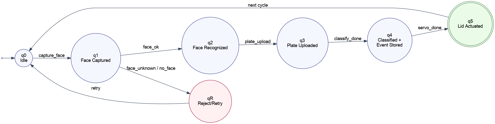
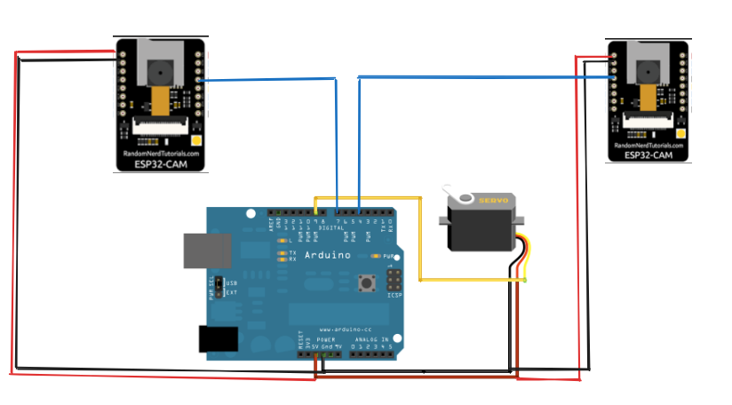

# Automata Hardware Project Documentation

## 1. Title of the Project
Smart Dustbin : Waste profiling system.

## 2. Objective
To develop a smart dustbin system that identifies users using face recognition, logs plate/waste events, classifies waste category, and controls lid actuation through ESP32 hardware.

## 3. Concept & Theory
Automata is a mathematical model used to represent systems with finite states and transitions based on inputs.

For this project:

M = (Q, Σ, δ, q₀, F)

- Q = {q0, q1, q2, q3, q4, q5, qR}
  - q0: Idle
  - q1: Face captured
  - q2: Face recognized
  - q3: Plate uploaded
  - q4: Waste classified and event stored
  - q5: Lid action completed
  - qR: Reject/Retry state
- Σ = {capture_face, face_ok, face_unknown, no_face, plate_upload, classify_done, servo_done, retry}
- δ:
  - δ(q0, capture_face) = q1
  - δ(q1, face_ok) = q2
  - δ(q1, face_unknown) = qR
  - δ(q1, no_face) = qR
  - δ(qR, retry) = q0
  - δ(q2, plate_upload) = q3
  - δ(q3, classify_done) = q4
  - δ(q4, servo_done) = q5
  - δ(q5, retry) = q0
- q₀ = q0
- F = {q5}

## 4. State Diagram
State flow:
Idle -> Face Captured -> Face Recognized -> Plate Uploaded -> Classified/Event Stored -> Lid Actuated -> Idle

Reject path:
Face Captured -> (Unknown/No Face) -> Retry -> Idle

## 5. Hardware Components Used
- ESP32-CAM (Face camera node)
- ESP32-CAM (Plate camera node)
- Servo motor (lid mechanism)
- Jumper wires and prototyping setup
- 5V power supply
- Wi-Fi network
- Host system running FastAPI backend

## 6. Circuit Design
- **Electronic Circuit (Lid Control Module):**
  - Servo VCC -> 5V supply
  - Servo GND -> Common GND
  - Servo Signal -> Control GPIO (Arduino test module uses D9, ESP32 integration uses control output logic)
  - Trigger/Input pin -> Digital input with pull-up/pull-down logic as configured in firmware
- Face ESP32-CAM exposes `/capture`, `/stream`, `/flash`, `/servo` APIs.
- Plate ESP32-CAM exposes `/capture`, `/stream`, `/flash` APIs.
- Flash control pin used on GPIO 4.
- Lid control uses GPIO 13 (`CONTROL_GPIO`) through servo state endpoint.
- Servo support also initialized on GPIO 14 in firmware.

Electronic circuit diagrams:
- 

## 7. Implementation / Working
1. User starts pipeline from web UI.
2. Backend captures face frame from face ESP32 camera.
3. Face embedding is extracted using InsightFace.
4. Match is performed using FAISS against enrolled embeddings.
5. If recognized, pipeline proceeds; otherwise user retries.
6. User uploads plate image.
7. Backend stores image and assigns waste category (current prototype uses category 1-4 placeholder logic).
8. Event is recorded with person, timestamp, face score, category, and servo status.
9. Servo control is triggered for lid actuation cycle.
10. System resets for next cycle.

## 8. Test Cases & Output
| Input | Expected Output | Actual Output |
|---|---|---|
| Start pipeline with enrolled face | Person recognized and upload step enabled | Recognized response returned, upload enabled |
| Start pipeline with unknown face | Unknown result and block next step | Unknown response returned |
| Start pipeline with no visible face | No-face message and retry | No-face response returned |
| Upload plate after recognition | Event saved, category assigned, lid cycle executed | Completed response with event and servo status |
| Debug open command | Lid open command sent | `sent_state=off` returned |
| Debug close command | Lid close command sent | `sent_state=on` returned |

## 9. Innovation / Unique Features
- End-to-end automata-based hardware workflow.
- Dual camera architecture (face + plate).
- Integrated recognition, waste logging, and lid actuation in one pipeline.
- Real-time dashboard and event analytics support.

## 10. Result
The complete system was implemented successfully. The project performs recognition, plate event logging, waste categorization (prototype stage), and lid actuation with persistent event tracking.

## 11. Challenges Faced
- Multi-device synchronization across two ESP32-CAM nodes.
- Face recognition consistency under lighting/angle changes.
- Reversed hardware control logic mapping for open/close states.
- Handling unknown/no-face cases robustly in the pipeline.

## 12. Conclusion
The project successfully demonstrates how automata theory can be applied to a real embedded system. The smart dustbin workflow is represented and validated through finite-state transitions from user detection to final lid actuation.

## 13. References
- Arduino Servo documentation: https://docs.arduino.cc/libraries/servo/
- Fritzing project website: https://fritzing.org/
- ESP32-CAM (AI Thinker) pin reference: https://randomnerdtutorials.com/esp32-cam-ai-thinker-pinout/
